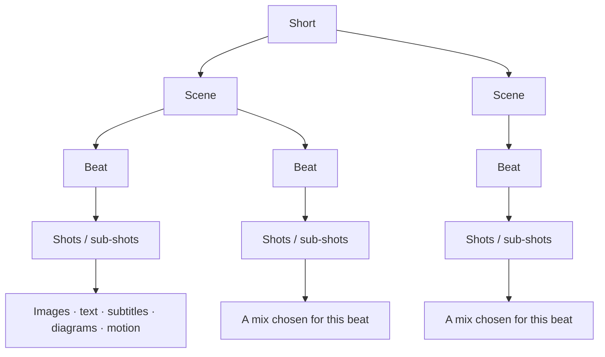
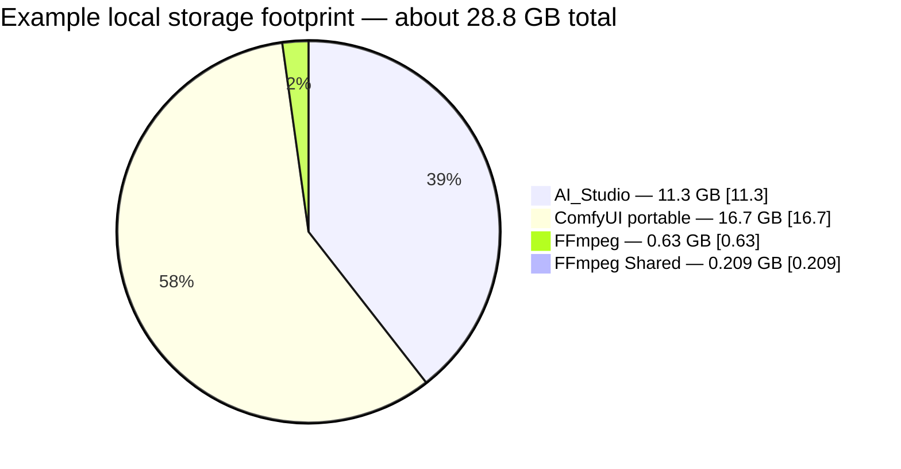

# Kestrel

**A local-first workspace for AI-assisted creative production.**

Kestrel brings together projects, models, assets, and tools for researching, planning, and producing video. **Kestrel Shorts** is the current short-form production project. The workspace also includes a shared search service and a separate Remotion composition project.

> AI helps prepare the work; human review guides the creative result.

## ✦ Kestrel Shorts

Kestrel Shorts is an evolving pipeline for creating vertical videos. It combines specialized agents with deterministic code and local media tools.

A video is organized as **Short → Scenes → Beats → Shots**. A beat is a storytelling or information unit; it may contain several shots and visual elements, such as generated images, subtitles, explanatory text, graphs, or animation. A shot is a visual representation of an idea or moment, not necessarily a filmed camera shot.



### Production workflow

The default workflow currently connects the first five stages. Additional review and media-production components are present in the project, with full workflow integration still in progress.

```mermaid
flowchart LR
    subgraph connected["Connected by default"]
        P["Prompt"] --> O["Orchestrator"]
        O --> R["Researcher"]
        R --> A["Architect"]
        A --> SR["Script Refiner"]
        SR --> SD["Story Director"]
    end

    SD -. "additional workflow integration in progress" .-> RV["Reviewer"]
    RV --> VD["Visual Director"]
    RV --> VOD["Voice Director"]

    VD --> IP["Image Prompter"]
    IP --> CU["ComfyUI"]

    VOD --> F5["F5-TTS"]
    F5 -. "fallback" .-> KO["Kokoro"]

    CU --> FS["Frame Supervisor and scene compiler"]
    F5 --> FS
    FS --> RM["Remotion composition"]
    RM --> FF["FFmpeg processing"]
    FF --> HR["Human review"]
```



The pipeline is designed so that narrative, visual, and voice plans can inform the production stages. In the current code, `WorkflowRunner`'s default stage sequence ends at **Story Director**; the diagram's downstream path describes project components and intended coordination, not a guarantee that every step runs automatically.

## 🧭 Agents and responsibilities

| Component | Role |
| --- | --- |
| **Orchestrator** | Interprets a request, selects a registered channel, and extracts preferences such as length or visual style. |
| **Researcher** | Gathers source-backed material for a video. |
| **Architect** | Shapes research into a structured story plan. |
| **Script Refiner** | Develops the plan into a draft script and selects a world from the channel's registered options. |
| **Story Director** | Develops the narrative and narration using the script, channel, world, and character context. |
| **Visual Director** | Plans shots and on-screen elements to support the narration. |
| **Voice Director** | Plans narration delivery, music, ambience, and sound effects. |
| **Reviewer** | Checks scripts and plans for issues before production. |
| **Image Prompter and media engines** | Prepare image prompts and coordinate local image, voice, and video tools. |
| **Frame Supervisor and Remotion** | Support composition and assembly of scenes into a video. |

The agents do not all have the same integration status. Their code is organized in the repository, while the default runner currently automates the early planning and scripting stages.

## 🌍 Channels, worlds, and characters

Kestrel separates a channel's identity from the setting of an individual story:

- A **channel** represents a genre and defines available worlds, characters, and visual guidance.
- A **world** describes the story setting and its contextual visual cues.
- A **character** brings a recurring personality and references an avatar and voice profile.
- A **voice profile** identifies a voice provider and can point to reference audio.

For example, the History channel registry lists the `ancient_history` world and its available characters. The registry files make these relationships explicit and reusable across videos. Visual styles guide how a channel communicates; they are not separate rendering systems.

## 🗂️ Inside the workspace

The tree below follows the selected AI_Studio workspace layout. It focuses on the project areas and omits generated files, dependency folders, and private environment values.

```text
AI_Studio/
├── Launcher/
├── Models/
│   ├── blobs/
│   ├── F5-TTS/
│   │   └── ref_voices/
│   ├── Kokoro/
│   ├── manifests/
│   ├── metadata/
│   └── Whisper/
├── Outputs/
│   ├── cache/
│   ├── Images/
│   ├── Shorts/
│   ├── Temp/
│   ├── uploads/
│   ├── vector_db/
│   └── Videos/
└── Projects/
    ├── ResearchAssistant/
    │   ├── .env.example
    │   ├── research.py
    │   └── search_service.py
    ├── Remotion/
    │   ├── package.json
    │   ├── remotion.config.ts
    │   └── src/
    └── Tools/
        ├── shorts/
        └── studio/
```

### Kestrel Shorts project map

The tree you shared is the baseline for this view. It shows the project's original agent, application, asset, avatar, and model organization. The current codebase also includes dedicated `composition/`, `core/`, `creative/`, `engines/`, `rendering/`, and `text/` areas; these are reflected in the map below.

```text
Projects/Tools/shorts/
├── agents/
│   ├── _common.py
│   ├── architect.py
│   ├── frame_supervisor.py
│   ├── image_prompter.py
│   ├── researcher.py
│   ├── reviewer.py
│   ├── script_refiner.py
│   ├── story_director.py
│   ├── visual_director.py
│   └── voice_director.py
├── app/
│   ├── orchestrator.py
│   ├── workflow_controller.py
│   └── workflow_runner.py
├── assets/
│   ├── asset_analyzer.py
│   ├── asset_geometry.py
│   ├── asset_manager.py
│   ├── avatar_pose_system.py
│   └── avatars_config.json
├── avatars/
│   ├── dragons/
│   ├── forge/
│   ├── genius/
│   ├── guests/
│   ├── history/
│   ├── mystery/
│   ├── mythology/
│   ├── science/
│   └── survival/
├── composition/
│   ├── composition_rules.py
│   └── layout_engine.py
├── core/
│   ├── models/
│   ├── registry/
│   ├── config.py
│   ├── llm.py
│   ├── registry_loader.py
│   ├── run_context.py
│   └── search.py
├── creative/
│   └── catalogs/
├── engines/
│   ├── audio/
│   ├── image/
│   ├── motion/
│   ├── video/
│   ├── visual/
│   └── voice/
├── rendering/
│   └── scene_renderer.py
└── text/
    └── typography_engine.py
```

- `agents/` contains specialized planning, directing, reviewing, and production agents.
- `app/` coordinates request interpretation and workflow state.
- `core/` defines shared configuration, data models, run context, registry loading, and search access.
- `core/registry/` stores structured definitions for channels, worlds, characters, avatars, voices, and themes.
- `creative/catalogs/` provides the controlled choices and guidance agents can use.
- `engines/` contains image, voice, audio, visual, and video processing components.
- `assets/` and `avatars/` support asset management, character artwork, canonical images, and poses.
- `composition/`, `text/`, and `rendering/` provide layout, typography, and scene-rendering support.

The complete per-character image and pose listing is intentionally not repeated here: the folder names above show where those assets live without turning the root README into an asset inventory.

## 🧰 Local toolchain

| Tool | Use |
| --- | --- |
| **Ollama** | Local language-model runtime; the Shorts configuration currently names `qwen3:8b`. |
| **ComfyUI** | Local image-generation service. |
| **F5-TTS** | Primary voice-generation provider in the current voice engine. |
| **Kokoro** | Fallback voice provider. |
| **Search service** | Shared local service used to retrieve research results. |
| **FFmpeg** | Media processing alongside the video workflow. |
| **React, TypeScript, and Remotion** | Video composition in the separate `Projects/Remotion/` project. |

The Remotion project uses Remotion **4.0.536**, React **19.2.3**, and TypeScript **5.9.3**. The checked-in package manifest provides its development, bundle, and lint scripts. The Shorts project currently relies on local services and model folders; a portable, end-to-end installation guide is not yet available.

## 💻 Example development setup

These figures describe one local setup, not minimum system requirements.

| Resource | Approximate amount |
| --- | ---: |
| CPU | AMD Ryzen 5 7235HS, 4 cores / 8 threads |
| Memory | 24 GB RAM |
| GPU | NVIDIA GeForce RTX 3050 Laptop GPU, 6 GB VRAM |
| `AI_Studio` workspace | 11.3 GB |
| ComfyUI portable installation | 16.7 GB |
| FFmpeg | 630 MB |
| FFmpeg Shared | 209 MB |

Approximate storage footprint:



The `AI_Studio` total includes project files, models, and assets. The Qwen 3 model data is approximately 6 GB, with a model blob of about 5 GB; the rest of the workspace consists of project files and other resources. Storage use will vary with installed models, generated media, and retained outputs.

## 🚧 Development status

Kestrel is under active development. The default Shorts runner currently covers request interpretation, research, planning, script refinement, and story direction. Visual planning, review, voice and image generation, scene compilation, and Remotion assembly have project code, with end-to-end workflow integration still in progress.

## 🤝 Contributing

Feedback and contributions are welcome. Setup and contribution instructions can be expanded as the installation and development workflows become more portable.

